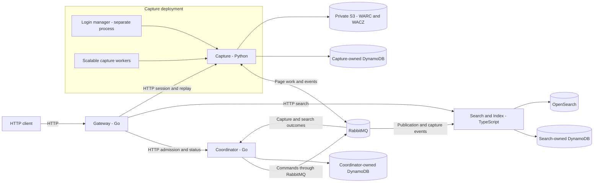

# ADR-0002: Service boundaries and implementation languages

- Status: Accepted
- Date: 2026-11-18

## Context

The assignment requires at least four microservices in at least three languages. The archive needs separate responsibilities for HTTP entry, long-running workflow coordination, page capture, and retrieval.

## Decision

Use four logical microservices:

- API Gateway (Go): stateless REST entry point and request validation.
- Archive Coordinator (Go): archive-job lifecycle and cross-service workflow coordination.
- Capture (Python): page discovery, browser capture, and crawl-specific processing.
- Search and Index (TypeScript): full-text indexing, querying, and historical retrieval.

Each service is independently deployed and has its own health check. Start with one Gateway, one Coordinator, and one Search and Index replica; use multiple Capture replicas for page-level work distribution.

Correctness must not depend on a service having exactly one running replica. The Gateway remains stateless, and the Coordinator's authoritative workflow state is durable rather than process-local. Concurrent Coordinator replicas must not produce invalid or duplicate state transitions when processing messages for the same archive. Replicas share only their own service's data, never another service's database.

## Service boundaries and communication

The deployment has **four logical services**, although Capture runs separate login-manager and scalable worker processes. Each stateful service owns its DynamoDB tables; arrows represent logical dependencies, not direct access to another service's tables. This diagram intentionally omits retry queues and internal API endpoints.

## Consequences

The gateway requires no application database. The coordinator need not implement crawler-specific URL rules. Service-to-service boundaries introduce event contracts and operational complexity, but allow failures and scaling to be demonstrated independently.

Initial replica counts are deployment defaults, not cardinality constraints. Making Coordinator transitions safe under concurrency requires atomic state changes and idempotency, whose mechanics will be specified in later ADRs. Replica safety does not imply high availability of shared infrastructure. Detailed state machines, internal module boundaries, and crawl-frontier algorithms remain separate decisions.
