# ADR-0014: Archive lifecycle and orchestrated SAGA

- Status: Accepted
- Date: 2026-11-18

## Context

An archive run spans independent services: Go coordinates the run, Python captures pages and stores artifacts, and TypeScript indexes captured pages. Capturing and indexing overlap, and a run may produce useful snapshots even when some pages cannot be captured or indexed. No atomic transaction spans the services' databases, S3 artifacts, and OpenSearch documents.

The archive must not expose uncommitted snapshots as successful historical versions. When a run-wide failure prevents publication, partial side effects must be compensated without erasing diagnostic evidence. Compensation can itself be delayed or retried, so an archive's failure and the completion of its cleanup are distinct facts.

## Decision

Use an orchestrated SAGA owned by the Go Archive Coordinator, with one durable SAGA instance per archive run. The Coordinator owns run-wide decisions and aggregate status; Python owns page-level capture/frontier state, and TypeScript owns page-level indexing state. Neither the Coordinator nor the Gateway manages per-page processing directly.

### Lifecycle and outcomes

The run progresses through the conceptual states `ACCEPTED`, `RUNNING`, and `FINALIZING` before reaching `COMPLETED` or `COMPLETED_WITH_ERRORS`. A pre-publication run-wide failure transitions to `COMPENSATING` and reaches `COMPENSATED` only after all required cleanup is durably confirmed.

- `COMPLETED`: the run's validated archival package was published without terminal capture/preservation failures.
- `COMPLETED_WITH_ERRORS`: the run's validated archival package was published, but one or more secondary pages or required resources had terminal capture/preservation failures. Search indexing failures are tracked separately and do not change the archive outcome.
- `COMPENSATING`: cleanup is still in progress; the run is not terminal.
- `COMPENSATED`: required rollback is complete; the archive run was unsuccessful, and no staged result remains publicly available.

The public archive outcome and internal SAGA state are separate concepts. A compensated run is publicly `FAILED`, not `COMPLETED`. The specific public API status representation is defined separately.

Crawling and indexing are concurrent activities, not mutually exclusive sequential SAGA states. The Coordinator transitions toward archival finalization after Python reports a terminal crawl outcome and prepares a validated WACZ package. Indexer accounting and eventual search visibility are independent derived outcomes: a crawl-completed event does not prove indexing completion, but indexing completion is **not** a prerequisite for archive publication (ADR-0027).

### Page-level fault isolation

Archiving is best-effort with a mandatory seed capture. The seed page must be captured successfully for the run to be publishable. Terminal failures of secondary pages do not cause a whole-run rollback, and a terminal indexing failure does not invalidate the successfully captured page artifact.

Successfully captured pages remain directly retrievable as historical snapshots after publication, even if indexing failed; those pages may be absent from full-text search. The client must be able to inspect per-page failure reasons and distinguish capture failures from indexing failures. A terminal failure means no further automatic retries are planned for that page in this run, not that capture can never succeed in a future run.

A failed seed capture or a run-wide integrity failure can cause compensation. Temporary infrastructure outages and worker crashes are recovery conditions, not automatically grounds for compensating a run.

### Publication boundary

Captured artifacts and index documents are staged while the run is active. Public historical retrieval and search must exclude staged versions until the run is committed. A run is eligible for publication only after the mandatory seed is captured, all admitted crawl tasks have terminal outcomes, and Capture has durably prepared and validated its WACZ package. OpenSearch availability and indexing completion are not publication gates.

The Coordinator durably records an irreversible publication decision before requesting replay publication and search activation. Once this decision is recorded, transient publication failures are resolved by retrying/reconciling rather than by compensating already-authorized results. The Coordinator records `COMPLETED` or `COMPLETED_WITH_ERRORS` after **Capture confirms archival replay publication**; Indexer search activation can converge later. Index progress and search health are exposed separately.

The published-state check must be enforced by retrieval and search paths; the mere presence of an artifact in S3 or a document in OpenSearch must not make staged content publicly visible. The precise publication and visibility protocol is defined in ADR-0027; search API ownership is defined in ADR-0029.

### Compensation boundary

Before the durable publication decision, the Coordinator may decide to abort a run. It durably enters `COMPENSATING`, requests cancellation of further work, and coordinates deletion of run-owned uncommitted S3 artifacts and staged OpenSearch documents. Failure metadata, aggregate outcomes, and diagnostic state are retained.

Compensation commands and their acknowledgements must be idempotent and resumable after crashes or broker outages. The Coordinator may mark the SAGA `COMPENSATED` only after all required cleanup is confirmed. If a dependency is unavailable, the run remains `COMPENSATING` with outstanding steps recorded; a cleanup timeout or exhausted retry budget must not be misreported as completed rollback.

Cancellation is not instantaneous. Late events, expired execution attempts, duplicated messages, and delayed workers must be prevented from restoring compensated state or reintroducing uncommitted artifacts after cleanup. Exact fencing, drain, and cleanup-order mechanisms are defined separately.

## Irreversible SAGA choice

```mermaid
stateDiagram-v2
    [*] --> ACCEPTED
    ACCEPTED --> RUNNING: Start crawl
    RUNNING --> FINALIZING: Terminal crawl outcome

    state "Awaiting replay publication" as ReplayPending
    FINALIZING --> ReplayPending: Seed succeeded and WACZ validated; commit PUBLISH
    ReplayPending --> COMPLETED: Capture confirms replay; no archive errors
    ReplayPending --> COMPLETED_WITH_ERRORS: Capture confirms replay; partial archive errors

    ACCEPTED --> COMPENSATING: Commit COMPENSATE
    RUNNING --> COMPENSATING: Commit COMPENSATE
    FINALIZING --> COMPENSATING: Commit COMPENSATE
    COMPENSATING --> COMPENSATED: Capture and Search cleanup confirmed

    note right of ReplayPending
        Internal phase only
        Public status remains FINALIZING
        Decision PUBLISH is irreversible
    end note

    COMPLETED --> [*]
    COMPLETED_WITH_ERRORS --> [*]
    COMPENSATED --> [*]
```

The **decision** (`PUBLISH` or `COMPENSATE`) is stored separately from public lifecycle status. The diagram's **Awaiting replay publication** node represents `decision=PUBLISH` while the externally visible run remains `FINALIZING`; it is **not** an additional public status. Only `FINALIZING` with a terminal crawl and validated WACZ can choose publication. Once `PUBLISH` is committed, recovery retries publication; it never takes the compensation path. `WAITING_FOR_AUTH` is a recoverable page-level blocking condition, not a SAGA state. Indexing completion is not on the publication path.

## Consequences

The design preserves successful page captures despite isolated failures and makes partial outcomes explicit to clients. It supports incremental indexing while avoiding prematurely published archives and distinguishes a completed rollback from a failed run with pending cleanup.

The Coordinator needs durable, replica-safe SAGA transitions, aggregate completion signals, publication decisions, and compensation progress. Participants must provide idempotent publication and cleanup behavior. Once publication is authorized, recovery favors convergence toward publication rather than attempting an unsafe distributed rollback.

This ADR does not specify message payloads, endpoint schemas, indexing visibility mechanics, artifact manifests, distributed fencing, outbox implementation, retry deadlines, or operator escalation for stalled compensation. Those details will be specified separately.
