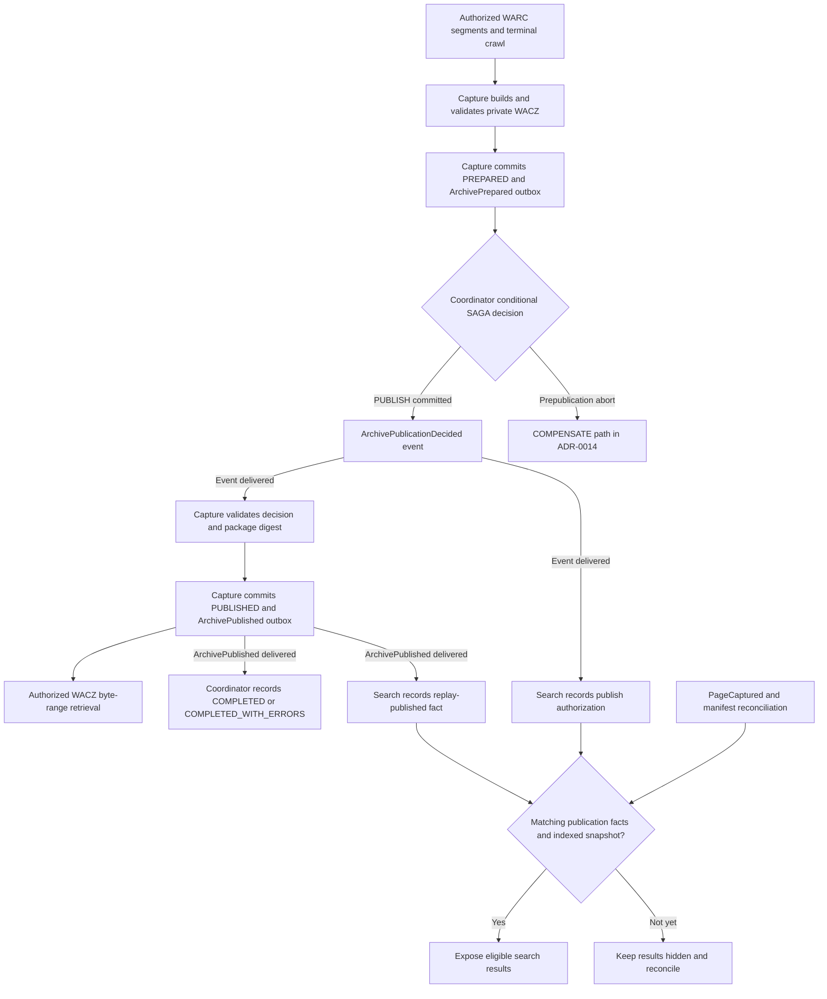

# ADR-0027: Archive publication, WACZ packaging, and replay visibility

- Status: Accepted
- Date: 2026-11-18

## Context

Capture produces independent WARC segments, the crawl manifest, and an eventual WACZ package. Indexing is incremental but Search & Index can be unavailable even after the archived content is ready for replay. A successful archive must be durable and replayable without waiting for a derived search projection to become available. The Coordinator must nevertheless prevent unfinished or compensated runs from appearing as published history.

No atomic transaction spans the Coordinator's DynamoDB state, Capture's S3 objects, and OpenSearch. ADR-0014 establishes an irreversible Coordinator-owned publication decision before participants expose committed results.

## Decision

### Prepare archival content

Capture reports crawl termination only after all admitted page and discovery tasks have durable terminal outcomes. The mandatory seed must have been captured successfully. Capture then assembles the **authorized, fenced WARC artifacts** into a portable WACZ, with indexes and metadata needed for ReplayWeb.page. Packaging may overlap indexing but occurs after the final crawl manifest identifies the included snapshots.

Capture writes the WACZ under an attempt-scoped or otherwise safely replaceable staging identity, validates its structure, indexes, included snapshots, and basic replayability, and durably reports **archive-prepared** to the Coordinator. Packaging is idempotent and recoverable after crashes. A run cannot publish without its validated WACZ. If packaging fails before the publication decision, it is retried or escalated to a documented run-wide failure/compensation path; a broken package is not a successful partial capture.

### Irreversible publication and independent search activation

The Coordinator requires a terminal crawl outcome, a successfully captured seed, and the validated WACZ preparation confirmation before making the durable **publish** decision. **Indexing completion or OpenSearch availability is not a prerequisite.** The Coordinator atomically excludes a conflicting compensate decision. A pre-publication run-wide failure follows ADR-0014 compensation; after publish is decided, unavailable participants are retried/reconciled, never rolled back.

WACZ objects remain private and immutable at their original S3 locations; publication changes **Capture-owned authorization metadata**, not object location, bucket ACL, or public S3 access. Capture makes the WACZ and corresponding historical snapshot references accessible only after durably applying publication authorization. The Coordinator marks the archive `COMPLETED` or `COMPLETED_WITH_ERRORS` once the archival replay path acknowledges publication. These archive outcomes reflect capture/preservation errors; indexing problems are tracked separately and do not downgrade a successfully published archive.

The Search & Index service may continue incremental work and reconcile against the final manifest. **Search result visibility requires both the Coordinator's matching `ArchivePublicationDecided` fact and Capture's matching `ArchivePublished` replay acknowledgment**; neither event arrival order nor existing OpenSearch documents alone authorize results. Search activation follows replay activation but does not block archive completion. Search activation and search-health status are separate from archive completion. If indexing is down, historical replay remains available; if capture/replay publication is still pending, the archive is not yet complete. An indexing outage or repair does not authorize staged or compensated documents to appear in search.

Completion of Capture and Search publication steps is **not** presented as a globally atomic, instantaneous visibility switch. Retrieval and search must check appropriate committed-run authorization before exposing results, and queries must never rely solely on whether an S3 object or OpenSearch document exists. Stale publication commands must not reverse run decisions.

### Historical replay

Use **self-hosted ReplayWeb.page** as the historical page replay engine, loading the authorized published WACZ rather than building an HTML rewriting/replay engine. A minimal replay delivery endpoint must support authenticated/authorized WACZ retrieval and HTTP byte ranges where required. Given a snapshot reference, the system resolves the correct package, original archived URL, and capture timestamp. Preserve normal navigation among captured historical pages without contacting the original site when recorded resources suffice; missing captures must not be misrepresented as saved.

Treat WACZ contents as potentially sensitive, especially authenticated page records. Isolate the replay execution origin from application credentials and APIs and ensure that staged/compensated archives cannot be downloaded or replayed. Detailed UI design is explicitly deferred.

## Publication and search-visibility ordering

This is a **dependency graph**, not a message-delivery timeline. All named cross-service events use the existing transactional outbox and RabbitMQ fan-out; the arrows denote logical prerequisites, not synchronous calls or delivery order. Search may receive `ArchivePublished` before `ArchivePublicationDecided` and must store both independently. Eligible indexed snapshots may become searchable after both matching publication facts are durable; **aggregate `SearchReady` can occur later**. Publication authorizes retrieval from the same private S3 object without copying it to a public bucket. A failed Search service never blocks archive completion.

## Consequences

The archive's authoritative deliverable is the preserved, validated WACZ; full-text search is a recoverable derivative. A client can access published archives while the Indexer is recovering. This intentionally supersedes the earlier assumption in ADR-0014/0019 that all indexing results must settle before archive publication.

The Coordinator must durably enforce the publish-versus-compensate boundary, while Capture must reconcile packaged artifacts and replay activation. Search's own completion and repair lifecycle remain independent. This protocol is not a two-phase commit and provides no cross-service instantaneous visibility guarantee.

The selected HTTP paths, message schemas and precise state/recovery protocol are documented in [OpenAPI 3.1](../../contracts/openapi/api.yaml) and the [message catalog](../../contracts/messages). Exact staging object keys, browser replay URL layout, WACZ packager implementation, and retry deadlines remain implementation details.
